# MiniDEX —— 基于 AMM 的去中心化交易所与原子套利

浙江大学区块链课程 2026 第二次作业：Build Your First DApp。

> 学号：3260200040　姓名：刘轩宇

本项目参考 Uniswap V2，实现了一个基于恒定乘积做市商（AMM）的去中心化交易所 DApp，前端通过 **MetaMask** 与本地 Hardhat 区块链交互。

## 功能概览

| 作业要求 | 实现方式 | 截图 |
| --- | --- | --- |
| 1. ERC20 Token 创建，多用户领取测试 Token 和 ETH | `TestToken`（TKA / TKB / TKC）的 `faucet()`；`EthFaucet` 的 `claim()`；MetaMask 导入多个账户分别领取 | [图 1–6](#1-部署与领取代币要求-1) |
| 2. 创建 AMM 交易池，恒定乘积定价（含手续费），交易与添加/撤销流动性接口 | `MiniDEX` 的 `createPool` / `swap` / `addLiquidity` / `removeLiquidity`，`address(0)` 表示 ETH，支持 A/B 与 A/ETH 池 | [图 7–15](#2-交易池与创建交易池要求-2) |
| 3. 添加流动性获得 ERC721 NFT（池子信息、数量、时间），查看流动性来源和自己的 NFT，销毁 NFT 取回代币和手续费分红 | `MiniDEX` 继承 `ERC721Enumerable`，链上生成 `tokenURI`；`getPoolPositions`、`getPositionsOf`、`positionValue` | [图 8、16–18](#4-添加流动性lp-nft-与销毁取回要求-3) |
| 4. 至少 10 个模拟用户随机交易、添加/撤销流动性 | `scripts/simulate.ts`：20 个随机钱包 + 1 个套利者 | [图 19–22](#5-多用户模拟要求-4) |
| Bonus 1（2 分）：多个交易所，相同代币对形成价差 | DEX Alpha（手续费 0.3%）与 DEX Beta（手续费 0.25%），初始价格不同 | [图 23–24](#6-套利bonus-1--2) |
| Bonus 2（3 分）：原子套利合约，一次交易完成，失败整体 revert，展示前后价格、数量和盈利 | `Arbitrage.sol` + `arbFinder.ts` + 前端套利页 | [图 25–30](#6-套利bonus-1--2) |

## 目录结构

```
contracts/                      Hardhat 3 合约工程
├── contracts/
│   ├── TestToken.sol           ERC20 测试代币（faucet 领取）
│   ├── EthFaucet.sol           ETH 水龙头
│   ├── MiniDEX.sol             AMM 交易所 + LP NFT（ERC721Enumerable）
│   └── Arbitrage.sol           原子套利合约
├── scripts/
│   ├── deploy.ts               部署全部合约、创建初始池子、导出地址和 ABI 给前端
│   ├── simulate.ts             多用户随机操作 + 自动套利模拟
│   └── arbFinder.ts            套利机会搜索算法（前端共用）
└── test/testMiniDEX.ts         合约单元测试（13 个用例）
frontend/                       React + Vite + ethers 6 前端
└── src/
    ├── App.tsx                 钱包连接、网络切换、页签、交易状态
    ├── lib/web3.ts             合约实例、通用工具
    ├── lib/arbFinder.ts        套利搜索（同 contracts/scripts/arbFinder.ts）
    ├── contracts/              部署脚本自动生成的地址和 ABI
    └── components/             账户、交易池、交易、流动性、套利、区块浏览器 六个页面
image/                          README 使用的运行截图
```

## 如何运行

环境要求：Node.js 22.13+ 或 24（推荐 24，见 `.nvmrc`）、Chrome 浏览器 + MetaMask 插件。需要同时开 **3 个终端**。

### 1. 安装依赖（只需一次）

```bash
cd contracts
npm ci
cd ../frontend
npm ci
```

### 2. 终端 1：启动本地 Hardhat 区块链（保持开启）

```bash
cd contracts
npm run node
```

RPC 为 `http://127.0.0.1:8545`，Chain ID 为 `31337`，自带 20 个各有 10000 ETH 的测试账户（启动时会打印地址和私钥）。

### 3. 终端 2：部署合约

```bash
cd contracts
npm run deploy
```

部署脚本会：

1. 部署 TKA、TKB、TKC 三个 ERC20 代币、ETH 水龙头、DEX Alpha（手续费 0.3%）、DEX Beta（手续费 0.25%）和套利合约；
2. 向 ETH 水龙头注资 50 ETH；
3. 用部署者账户（Account #0）创建 7 个初始池子：两个交易所都有 TKA/TKB、TKB/TKC、TKA/ETH 池，Alpha 另有 TKC/TKA 池（用于三角套利）。两个交易所的 TKA/TKB 初始价格不同（1:1 和 1:1.1），一开始就存在价差；
4. 把合约地址和 ABI 写入 `frontend/src/contracts/`，前端无需手动修改地址。

### 4. 终端 3：启动前端（保持开启）

```bash
cd frontend
npm start
```

打开 <http://localhost:3000>。

### 5. 配置 MetaMask

1. MetaMask → 添加网络 → 手动添加：网络名称 `Hardhat Local`、RPC `http://127.0.0.1:8545`、Chain ID `31337`、货币符号 `ETH`；
2. 导入账户：粘贴终端 1 打印的 **Account #1** 的私钥（建议不要用 Account #0，它是部署者，已经持有代币和初始池子的 LP NFT）。需要多个用户时，再导入 Account #2、#3……；
3. 网页右上角选择「MetaMask」→「连接 MetaMask」。新版 MetaMask 会为每个网站单独记住网络，若网页显示 `Chain 1` 和红色警告，点击警告中的「**一键切换到 Hardhat Local**」即可；
4. 之后每次领取、兑换、建池、添加/移除流动性、套利，MetaMask 都会弹出确认窗口；第一次让某个合约使用某种代币时，会先弹出授权（Spending cap）窗口。

> 网页右上角也可以切换为「本地节点账户」模式：直接使用节点内置的 20 个账户签名，不弹出 MetaMask，适合快速切换多个用户测试。

### 6. 终端 2：运行多用户模拟

```bash
npm run simulate
```

可以通过环境变量调整（PowerShell 写法，例如 `$env:ROUNDS="20"; npm run simulate`）：

| 变量 | 默认值 | 说明 |
| --- | --- | --- |
| `USERS` | 20 | 模拟用户数量 |
| `ROUNDS` | 150 | 随机操作次数 |
| `ARB_EVERY` | 10 | 每隔多少次操作让套利者扫描并套利一次，0 表示关闭 |
| `USER_ETH` | 2 | 每个模拟用户获得的 ETH |

### 7. 运行测试

```bash
cd contracts
npm test
```

```bash
cd frontend
npm test
```

### 8. 重新开始

本地链的数据只保存在内存中，重启后是一条全新的链：

1. 终端 1：`Ctrl + C` 后重新执行 `npm run node`；
2. 终端 2：重新执行 `npm run deploy`（合约地址每次都相同）；
3. 网页按 F5 刷新；
4. MetaMask：设置 → Developer tools → **Delete activity and nonce data**（每个使用过的账户都要切换过去各做一次），否则会出现 nonce 错误。导入的账户无需删除。

> 使用 Ganache 时：`npm run deploy:ganache` / `npm run simulate:ganache`，并用环境变量 `GANACHE_RPC_URL` 指定 RPC 地址；Ganache 默认每个账户只有 100 ETH，可用 `FAUCET_ETH`、`USER_ETH` 调小注资数量。

## 功能实现分析

### 1. ERC20 代币与水龙头

- `TestToken` 继承 OpenZeppelin `ERC20`，`faucet()` 每次为调用者铸造 1000 个代币，任何地址都可以领取，用来模拟多个用户。
- `EthFaucet` 由部署者注资，`claim()` 每次向调用者转 1 ETH。
- 前端「账户 & 水龙头」页显示 ETH、TKA、TKB、TKC 余额并提供领取按钮；「添加到 MetaMask」通过 `wallet_watchAsset` 让钱包显示这些代币。

### 2. AMM 交易池（`MiniDEX.sol`）

- **池子管理**：一个 MiniDEX 合约管理多个池子，`pools[poolId]` 保存 `tokenA/tokenB`、储备量、总流动性、累计手续费、交易次数、创建时间和创建者。以排序后的代币对为键，保证每个交易所内一个代币对只有一个池子（A/B 与 B/A 视为同一对）。
- **ETH 支持**：用 `address(0)` 表示原生 ETH。涉及 ETH 的函数为 `payable`，转入时校验 `msg.value`，转出时用 `call` 发送，因此 ERC20/ETH 池和 ERC20/ERC20 池共用同一套逻辑。
- **创建池子**：`createPool(tokenA, tokenB, amountA, amountB)` 创建池子并注入初始流动性，初始数量之比即初始价格。前端可以选择已有代币，也可以输入任意自己持有的 ERC20 地址。
- **定价公式**（与 Uniswap V2 相同）：

  ```
  amountInWithFee = amountIn × (10000 − feeBps)
  amountOut = amountInWithFee × reserveOut / (reserveIn × 10000 + amountInWithFee)
  ```

  即 `(x + Δx·(1−f)) · (y − Δy) = x · y`。
- **交易**：`swap(poolId, tokenIn, amountIn, minAmountOut)`，`minAmountOut` 是滑点保护。前端实时显示预计获得数量、当前价格、成交均价、价格影响和手续费，并列出另一个交易所同一代币对的报价。
- **手续费与分红**：全部 `amountIn`（含手续费）都计入储备，所以每笔交易后 `k = x·y` 都会略微增大。手续费不单独分配，而是留在池子里，使每一份流动性对应的储备变多；LP 销毁 NFT 时按份额取回，就自然拿到了手续费分红（Uniswap V2 的做法）。合约另外记录 `feeAccA/feeAccB`，仅用于展示累计手续费。
- **安全**：使用 `ReentrancyGuard` 防重入，`SafeERC20` 处理代币转账；首次注入时永久锁定 `MINIMUM_LIQUIDITY = 1000` wei 的流动性，防止份额操纵攻击（同 Uniswap V2）。

### 3. 流动性与 LP NFT

- **添加流动性**：`addLiquidity(poolId, amountADesired, amountBDesired)` 按当前储备比例计算实际注入量，多出的部分不会扣除（多余的 ETH 会退回）。份额计算：
  - 首次：`liquidity = sqrt(amountA × amountB) − MINIMUM_LIQUIDITY`
  - 之后：`liquidity = min(amountA × total / reserveA, amountB × total / reserveB)`
- **LP NFT**：MiniDEX 本身继承 `ERC721Enumerable`，每次添加流动性铸造一个 NFT，`positions[tokenId]` 记录池子 ID、流动性份额、存入的两种代币数量、注入时间和最初提供者。`tokenURI` 在链上生成 base64 JSON 元数据。两个交易所各有独立的 NFT 合集（ALP / BLP），因此编号各自独立（图 17 中同时出现 DEX Alpha 的 #21 和 DEX Beta 的 #21）。
- **撤销流动性**：`removeLiquidity(tokenId)` 只允许 NFT 持有人调用，按 `liquidity / totalLiquidity` 取回两种代币（含累计手续费），然后销毁 NFT。
- **查询**：`getPoolPositions(poolId)` 返回池子的全部流动性来源；`getPositionsOf(owner)` 返回某地址的全部 NFT；`positionValue(tokenId)` 返回当前可取回的数量。
- **前端**：「交易池」页可展开每个池子的「流动性来源」；「流动性 & NFT」页输入一侧数量会按比例自动算出另一侧并显示预计份额；「我的流动性 NFT」列出存入量、当前可取回量、按当前价格折算的盈亏（手续费收益减去无常损失），可以查看链上元数据或销毁取回。

### 4. 多用户模拟（`scripts/simulate.ts`）

- 生成 20 个随机钱包和 1 个套利者钱包（不是终端 1 的内置账户），由部署者转入 ETH，每个钱包领取三种代币并授权给两个交易所和套利合约。
- 每轮随机挑一个用户随机执行：60% 兑换（随机交易所、随机池子、随机方向，数量为储备的 0.5%–4%），20% 添加流动性，12% 销毁自己的一个 NFT 撤出流动性，8% 领取水龙头。
- 每隔 `ARB_EVERY` 轮由套利者扫描并执行最优套利，打印路径、利润和套利前后的价格。
- 结束时打印各操作次数、每个池子的储备、价格、交易次数、累计手续费、LP 数量，以及套利者的资产变化。

### 5. Bonus 1：多个交易所与价差

- 部署两个 MiniDEX 实例（DEX Alpha 0.3%、DEX Beta 0.25%），每个交易所有自己的池子和 LP NFT 合集。
- 相同代币对在两个交易所的初始价格不同，模拟用户在两个交易所独立随机交易，进一步拉开价差。
- 前端「套利」页按代币对汇总各交易所价格并显示最大价差；「交易」页显示另一个交易所的对比报价；「制造价差」按钮会在第一个池子做一笔大额交易，方便演示。

### 6. Bonus 2：原子套利合约（`Arbitrage.sol`）

- `executeArbitrage(steps, amountIn, minProfit)`：`steps` 是一条兑换路径，每一步指定交易所、池子和卖出的代币，起点代币必须等于终点代币。合约收取 `amountIn`，依次调用各交易所的 `swap`，最后检查：

  ```solidity
  require(amount >= amountIn + minProfit, "Arbitrage: not profitable");
  ```

  不满足就 revert。所有兑换都在同一笔交易里，**任何一步失败或利润不足都会让整笔交易回滚**，池子和用户资产完全不变，套利者只损失 gas。
- 支持两类路径（路径中可以包含 ETH 池）：
  - 跨交易所：`TKA →[Alpha] TKB →[Beta] TKA`（在便宜的交易所买入，到贵的交易所卖出）；
  - 三角套利：`TKA →[Alpha] TKB →[Beta] TKC →[Alpha] TKA`，可以在同一交易所内，也可以跨交易所组合。
- **价差检测与最优数量**（`arbFinder.ts`）：读取所有池子的储备，枚举全部 2 步和 3 步环路，在本地用与合约完全相同的公式模拟。利润函数 `f(x) = 路径输出(x) − x` 是凹函数，用三分搜索求最优投入量（不超过当前账户余额），按利润率排序。
- **前端展示**：「执行套利」后展示套利前后每个相关池子的价格和储备、起始代币余额变化和实际利润。「失败测试」会把最低利润设为预期利润的 10 倍，交易上链后以 `Arbitrage: not profitable` revert，页面显示余额和池子储备都没有变化，用来验证原子性。
- 套利后各池子价格趋于一致：两个交易所之间剩余的价差约等于两边手续费之和（0.3% + 0.25%），再小就无利可图。

### 7. 区块浏览器

Hardhat 节点没有 Ganache 那样的图形界面，所以前端内置了「区块浏览器」页：列出最近 30 个区块中的每笔交易（区块号、时间、哈希、发送者、目标合约名称、调用函数、ETH、Gas、成功/失败），点击后显示用 ABI 解码的函数参数和事件（`Swap`、`LiquidityAdded`、`ArbitrageExecuted` 等）。失败的交易显示「失败（已回滚）」。

## 项目运行截图

以下截图均为本地 Hardhat 链 + MetaMask（Account #1，地址 `0x7099…79C8`）实际运行的画面。

### 1. 部署与领取代币（要求 1）

**图 1　部署合约**：`npm run deploy` 输出 7 个合约地址，并创建初始池子。

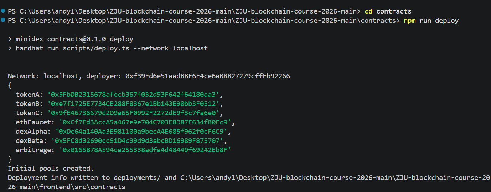

**图 2　MetaMask 交易确认窗口**：点击「领取 1000」后 MetaMask 弹出交易请求。网络为 Hardhat Local，请求来源为 `localhost:3000`，交互对象 `0x5FbDB…80aa3` 正是 TKA 代币合约；网页上方显示「等待确认」。


**图 3　领取成功**：交易被打包进区块 476，TKA 余额从 0 变为 1,000；ETH 只扣除了少量 gas。右下角是 MetaMask 的「Transaction 0 confirmed」通知（该账户的第一笔交易，nonce = 0）。


**图 4　添加到 MetaMask**：点击「添加到 MetaMask」，钱包弹出「加入建议的代币」窗口，列出 TKA / TKB / TKC 及余额。

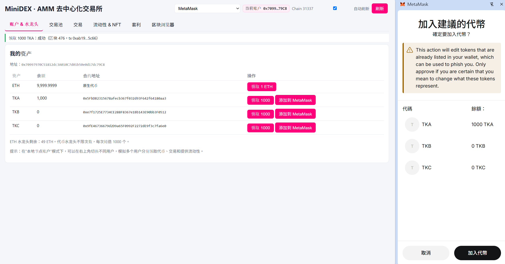

**图 5–6　MetaMask 钱包**：左图为钱包中显示的代币（TKA 1,000）；右图为导入的两个账户（Account #1 `0x70997…c79C8` 与 Account #2 `0x3C44C…293BC`），用于模拟不同用户分别领取和交易。

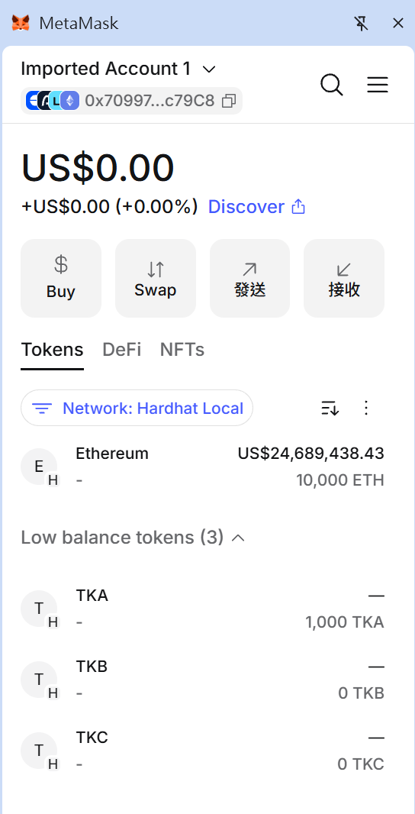 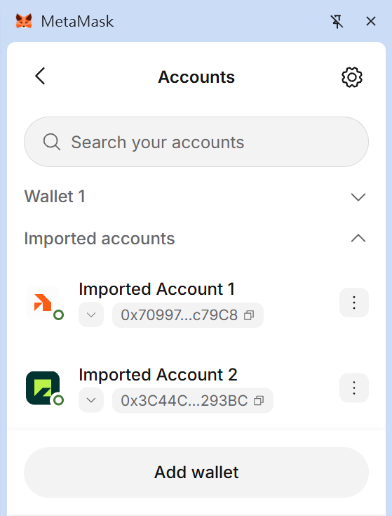

### 2. 交易池与创建交易池（要求 2）

**图 7　交易池页**：两个交易所的全部池子，显示储备量、价格、`k = x·y`、累计手续费和交易次数。

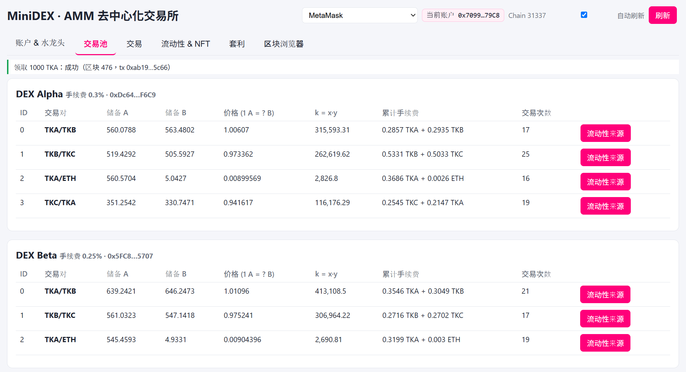

**图 8　流动性来源**：展开 DEX Alpha #0 TKA/TKB 池，列出每个 LP NFT 的持有人、提供者、份额、占比、存入数量、当前可取回数量和时间。#1 是部署者创建池子时获得的 NFT，其余来自模拟用户。

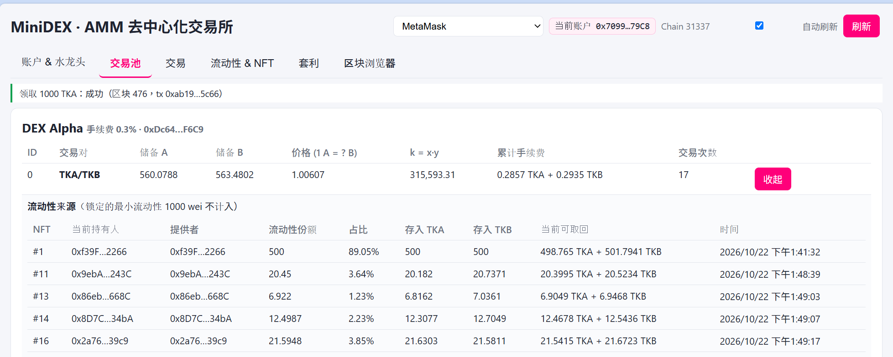

**图 9　创建交易池**：在 DEX Beta 创建 TKA/TKC 池，各注入 100 个，初始价格即为 1:1。

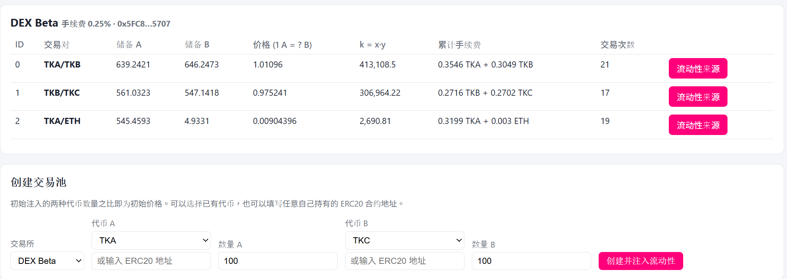

**图 10　MetaMask 授权窗口**：第一次让 DEX Beta（Spender `0x5FC8d…75707`）使用 TKA 时，MetaMask 先弹出 Spending cap request（额度为无限），确认后才发送 `createPool` 交易。


**图 11　创建成功**：DEX Beta 出现新的 #3 TKA/TKC 池（储备 100 / 100，价格 1.00000，区块 481）。交易记录中可以看到第一次创建失败（revert）：当时账户还没有 TKC，余额不足，合约拒绝了交易；领取 TKC 后再次创建就成功了。（截图中前端只显示 `unknown custom error`；现在的版本已能解析代币合约抛出的错误，会直接显示「代币余额不足：需要 100，当前余额 0（ERC20InsufficientBalance）」。）

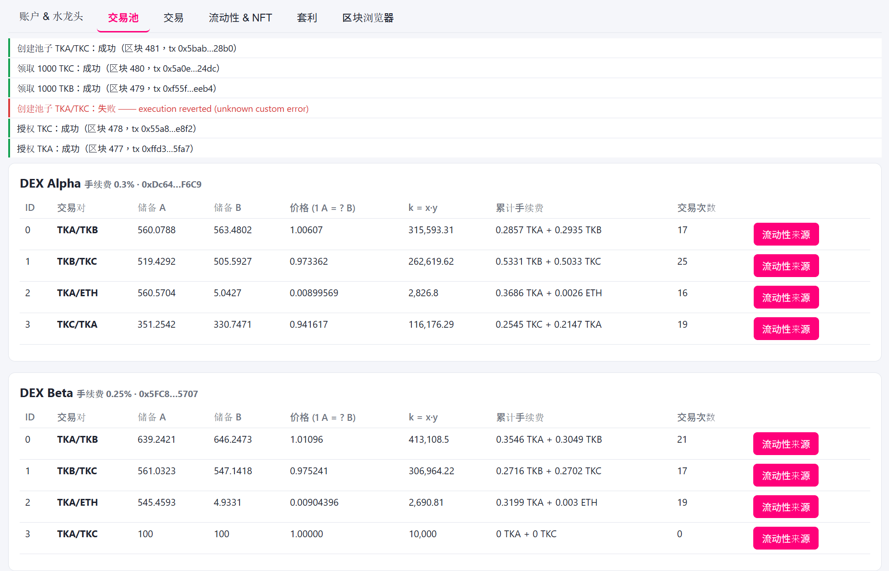

### 3. 兑换代币（要求 2）

**图 12　报价**：在 DEX Alpha #0 卖出 10 TKA，预计获得 9.855118 TKB；当前价格 1.00607、成交均价 0.985512、价格影响 2.044%、手续费 0.03 TKA（归 LP）。下方对比显示同样数量在 DEX Beta #0 能换到 9.929371 TKB，即两个交易所存在价差。

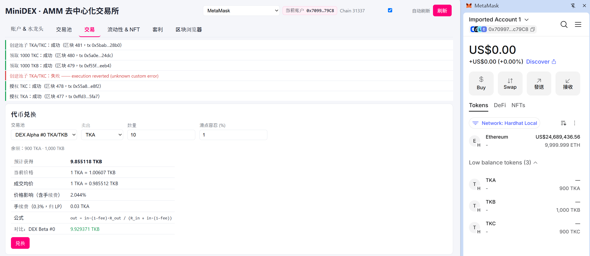

**图 13–14　授权与交易确认**：先授权 DEX Alpha（`0xDc64a…cF6C9`）使用 TKA，再确认 `swap` 交易，交互对象为 DEX Alpha。

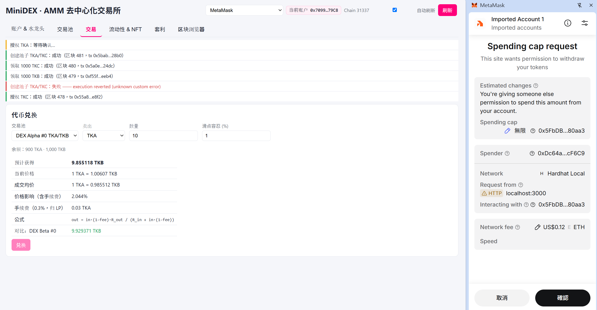

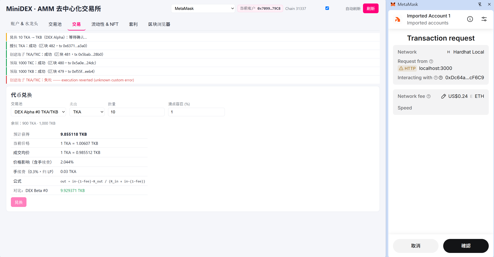

**图 15　兑换成功**：区块 483，余额变为 890 TKA / 1,009.8551 TKB，与报价一致；池子价格从 1.00607 降到 0.971138（卖出 TKA 使池中 TKA 变多，TKA 变便宜）。

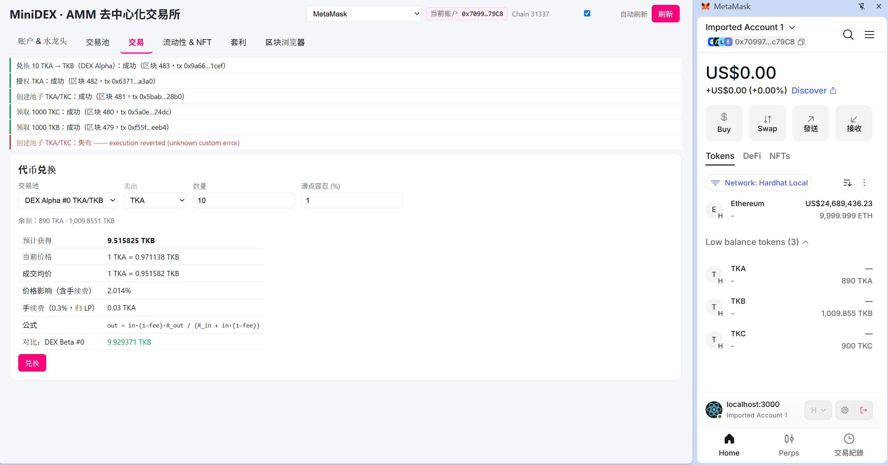

### 4. 添加流动性、LP NFT 与销毁取回（要求 3）

**图 16　添加流动性**：输入 10 TKA 后自动按池子比例算出 9.7114 TKB，预计获得份额 9.8489（占池子 1.72%）。下方「我的流动性 NFT」中已有创建 TKA/TKC 池时获得的 DEX Beta NFT #21。

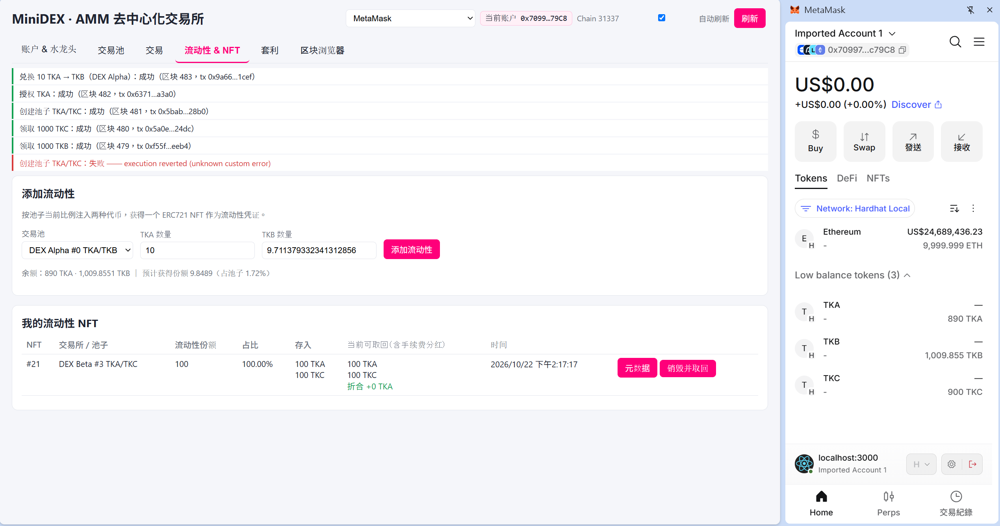

**图 17　NFT 与链上元数据**：添加成功后获得 DEX Alpha NFT #21（与 DEX Beta 的 #21 属于不同合集）。点击「元数据」显示合约 `tokenURI` 返回的 JSON：交易所、池子 ID、交易对、流动性份额、存入数量和创建时间（以 18 位小数的原始值表示）。

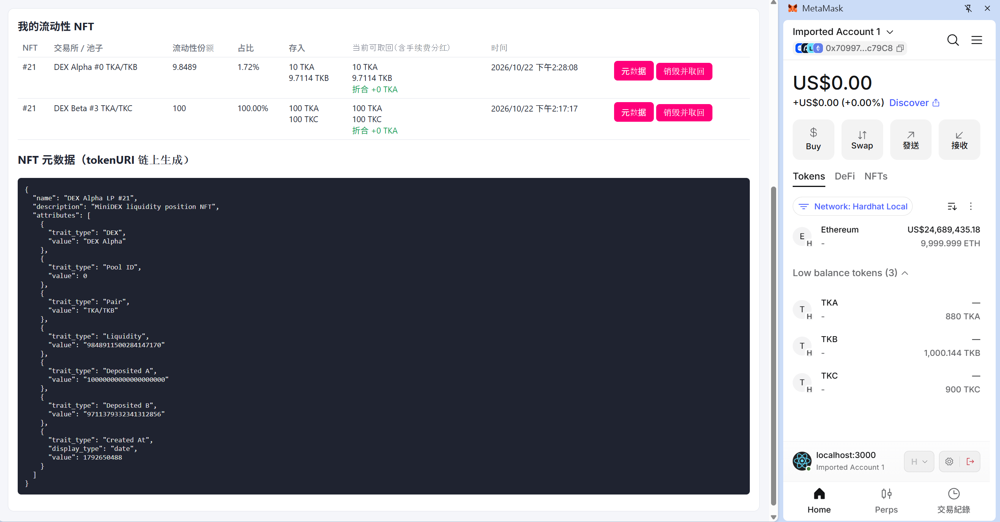

**图 18　销毁 NFT 取回**：销毁 DEX Beta NFT #21（区块 486），取回 100 TKA + 100 TKC，NFT 从列表中消失，余额恢复为 980 TKA / 1,000 TKC。


### 5. 多用户模拟（要求 4）

**图 19　模拟开始**：`npm run simulate` 创建 20 个模拟用户和 1 个套利者，不同地址随机执行 `[swap]`、`[add]`、`[remove]`、`[faucet]`；套利者每 10 轮执行一次套利，例如三角套利 `Alpha#0 → Alpha#3 → Alpha#1` 获利 0.802804 TKB（7.48%），跨交易所套利 `Alpha#2 → Beta#2` 获利 0.790846 TKA。

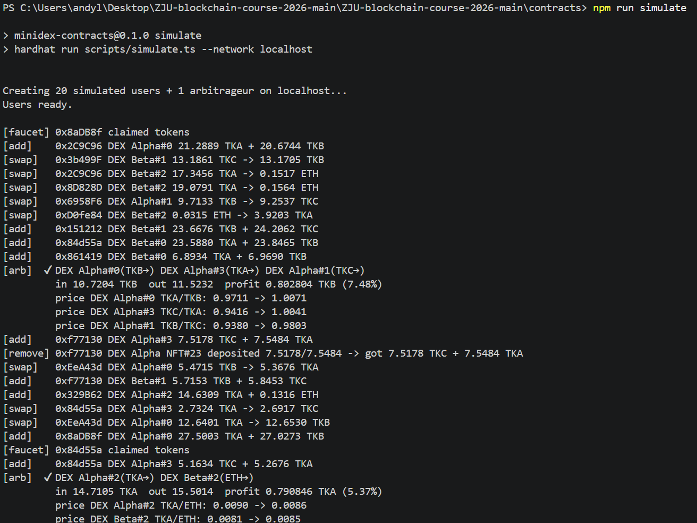

**图 20　模拟完成**：150 轮共执行 swap 91 次、add 41 次、remove 11 次、faucet 7 次、套利 15 次，失败 0 次；列出每个池子的最终状态和 LP 数量。套利者的 TKA、TKB、TKC 都增加，ETH 只减少了 gas。

> DEX Beta #3 TKA/TKC 的储备显示 0.0000：因为图 18 中这个池子唯一的 LP 已经撤出全部流动性，池中只剩永久锁定的 `MINIMUM_LIQUIDITY`（1000 wei）。这正是该机制的作用：池子永远不会被完全清空，份额价格也就无法被操纵。

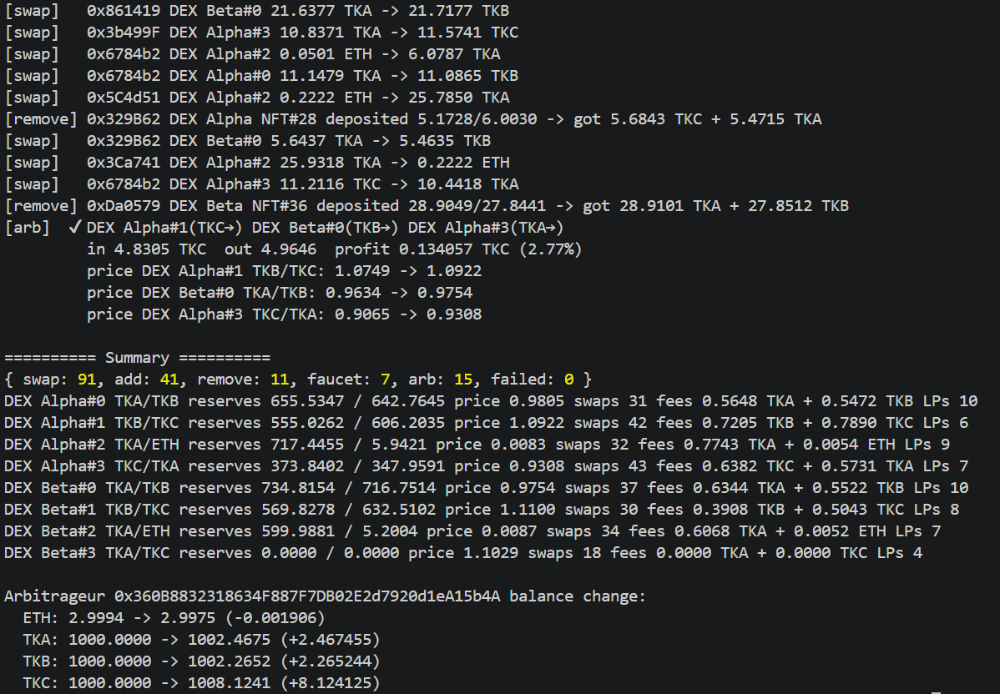

**图 21　模拟后的流动性来源**：DEX Alpha #1 TKB/TKC 池中出现多个模拟用户的 LP NFT（#18、#30、#33、#34、#35），说明模拟用户的操作真实上链。

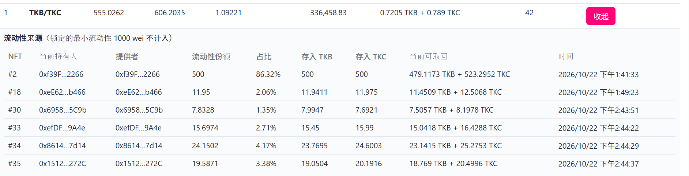

**图 22　区块浏览器中的模拟交易**：大量来自不同发送者的 `swap`、`removeLiquidity`、`executeArbitrage` 交易，全部成功。

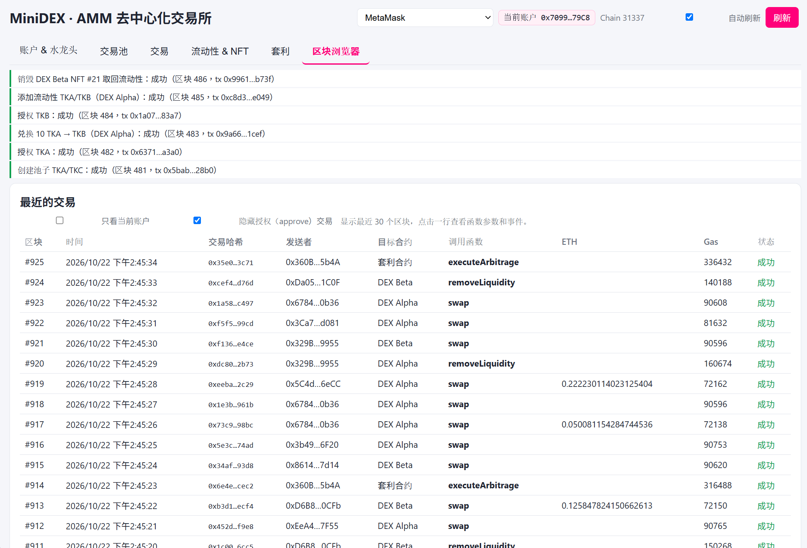

### 6. 套利（Bonus 1 & 2）

**图 23　价格对比**：同一代币对在两个交易所的价格与最大价差，例如 TKA/ETH 价差 4.651%；下方列出当前账户可执行的套利机会。

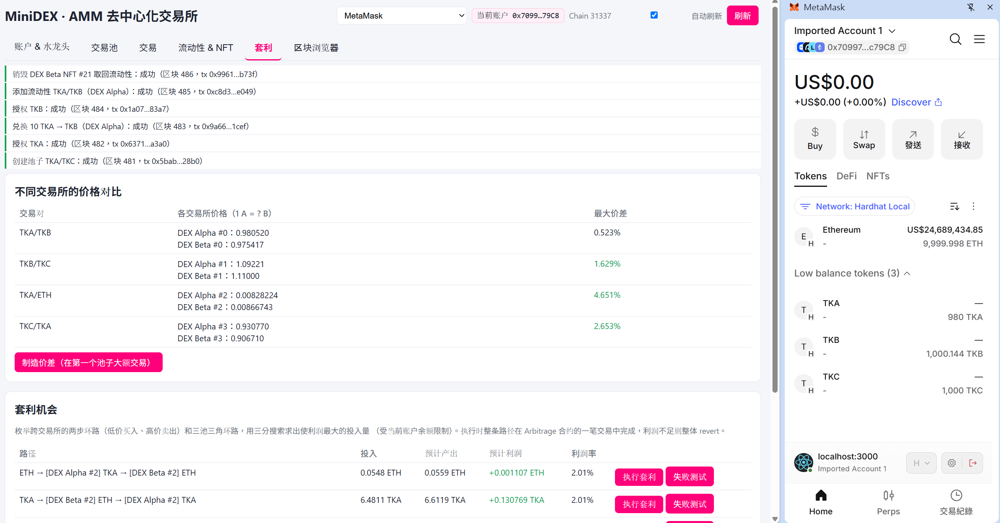

**图 24　制造价差**：点击「制造价差」在 DEX Alpha #0 大额卖出 TKB（区块 926），TKA/TKB 的价差从 0.523% 扩大到 21.600%。

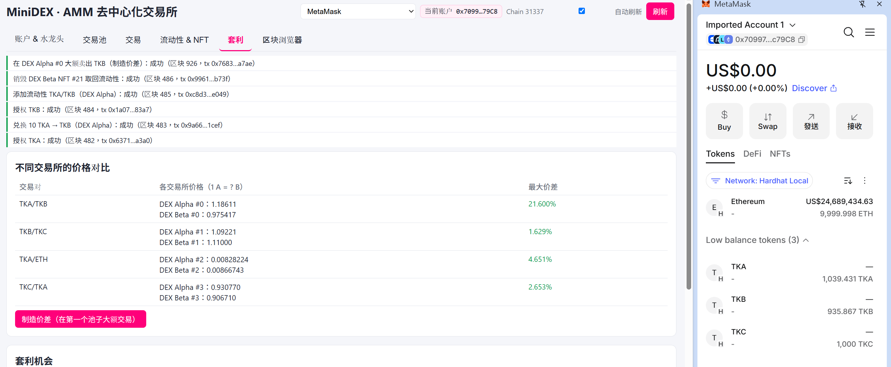

**图 25　套利机会列表**：枚举所有 2 步和 3 步环路并按利润率排序，最优是三角套利 `TKA →[Alpha #0] TKB →[Beta #1] TKC →[Alpha #3] TKA`，投入 14.1393 TKA，预计利润 1.44632 TKA（10.22%）。列表末尾投入量为 `e-17` 的路径经过几乎为空的 DEX Beta #3，利润可以忽略。

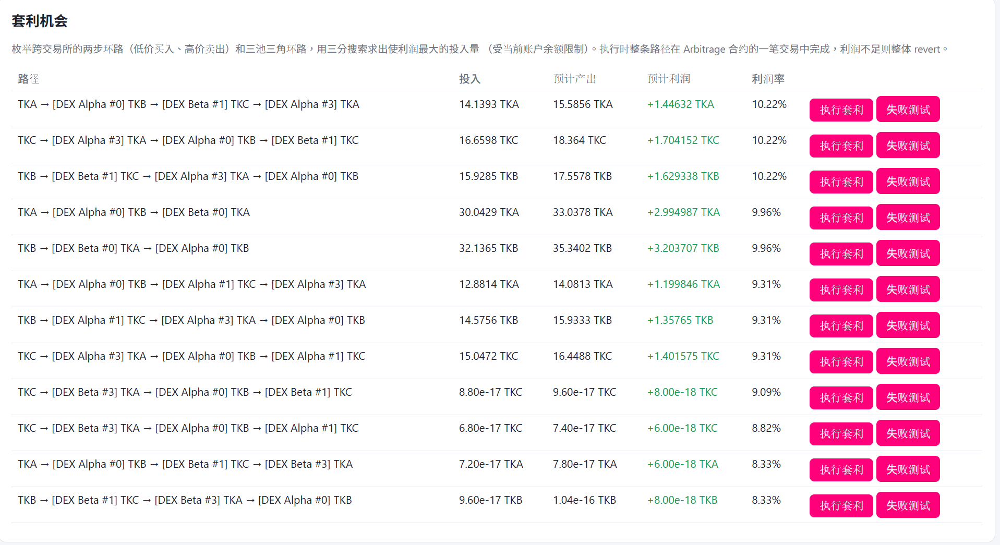

**图 26–27　套利成功**：执行上述三角套利（授权在区块 927，套利在区块 928）。TKA 余额 1,039.431486 → 1,040.877806，实际利润 +1.44632 TKA，与预计完全一致；三个池子的价格和储备都发生变化，DEX Alpha #0 的 TKA/TKB 价格从 1.18611 回落到 1.13186，两个交易所的价差从 21.6% 缩小到 16.0%。

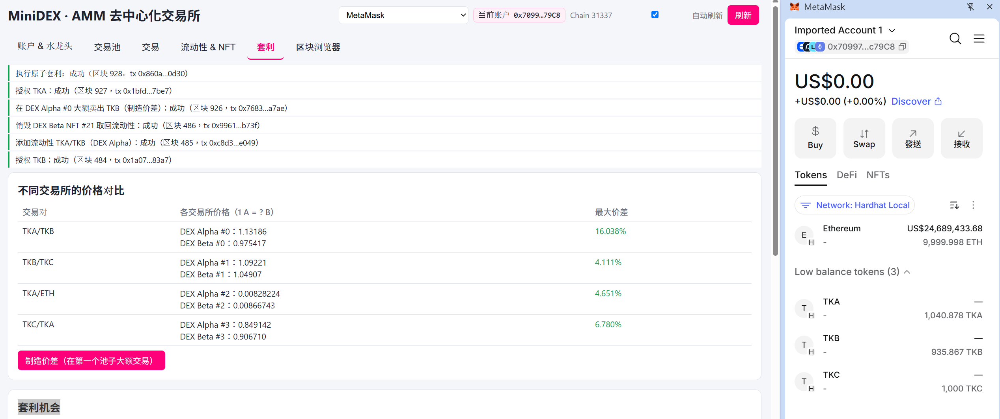

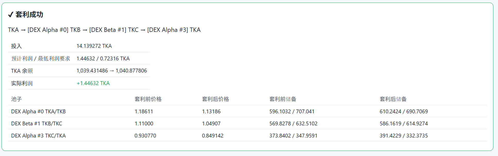

**图 28–29　失败测试**：「失败测试」把最低利润设为预计利润的 10 倍（1.720456 → 17.20456 TKA）。交易以 `Arbitrage: not profitable` revert，TKA 余额 1,040.877806 → 1,040.877806 完全不变，两个池子的价格和储备也完全不变，证明套利是原子性的。

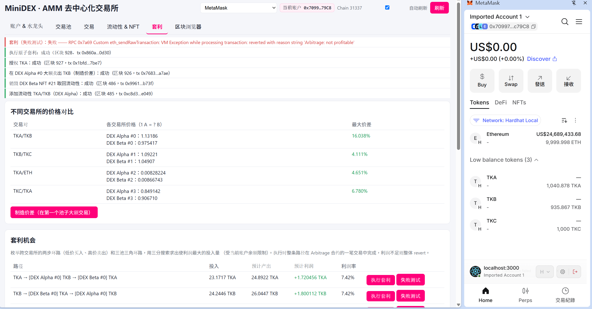

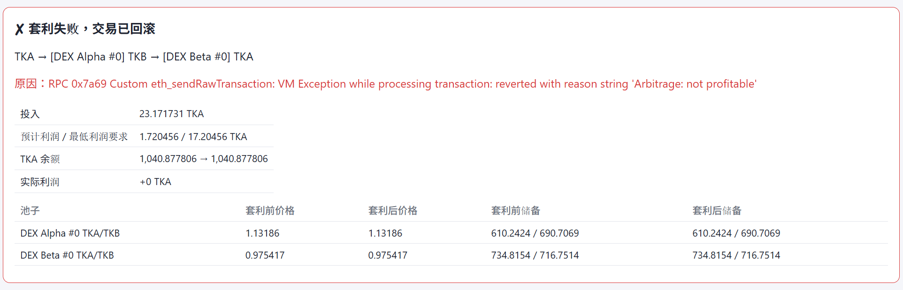

**图 30　区块浏览器**：本账户的操作依次为区块 #926 `swap`（制造价差）、#927 `approve`、#928 `executeArbitrage` 成功、#929 `executeArbitrage` 失败（已回滚）。失败的交易同样被打包进区块并消耗了 gas，只是所有状态变化都被撤销。

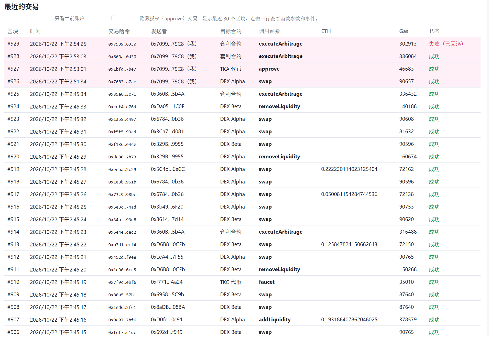

### 7. 单元测试

**图 31**：`npm test` 运行 13 个合约测试用例，全部通过。

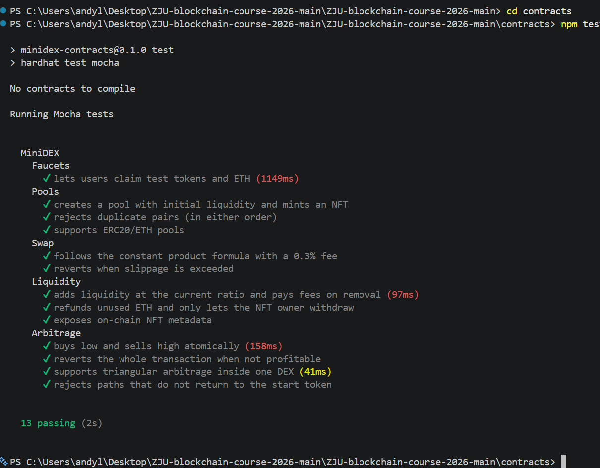

## 测试

- `contracts/test/testMiniDEX.ts`（`npm test`，13 个用例）：水龙头、建池、重复代币对、ETH 池、恒定乘积与手续费、滑点保护、按比例添加流动性和手续费分红、ETH 退款与 NFT 权限、链上元数据、跨交易所套利、无利润时整笔回滚、三角套利、非法路径。
- `frontend/src/App.test.tsx`（`npm test`）：页面渲染、前端定价公式、套利搜索。

## 参考内容

- 课程参考 Demo：[DEMOs](https://github.com/LBruyne/blockchain-course-demos)
- [Uniswap V2 Core](https://github.com/Uniswap/v2-core)、[Uniswap V2 白皮书](https://uniswap.org/whitepaper.pdf)：恒定乘积公式、手续费、`MINIMUM_LIQUIDITY`
- [Uniswap V2 Periphery Router](https://github.com/Uniswap/v2-periphery)：按比例添加流动性的计算
- [OpenZeppelin Contracts 5](https://docs.openzeppelin.com/contracts/5.x/)：ERC20、ERC721Enumerable、SafeERC20、ReentrancyGuard、Base64
- [WTF Academy：DEX](https://www.wtf.academy/en/docs/solidity-103/DEX/)
- [ethers v6 文档](https://docs.ethers.org/v6/)
- 本项目使用 AI（Claude）辅助编写。
